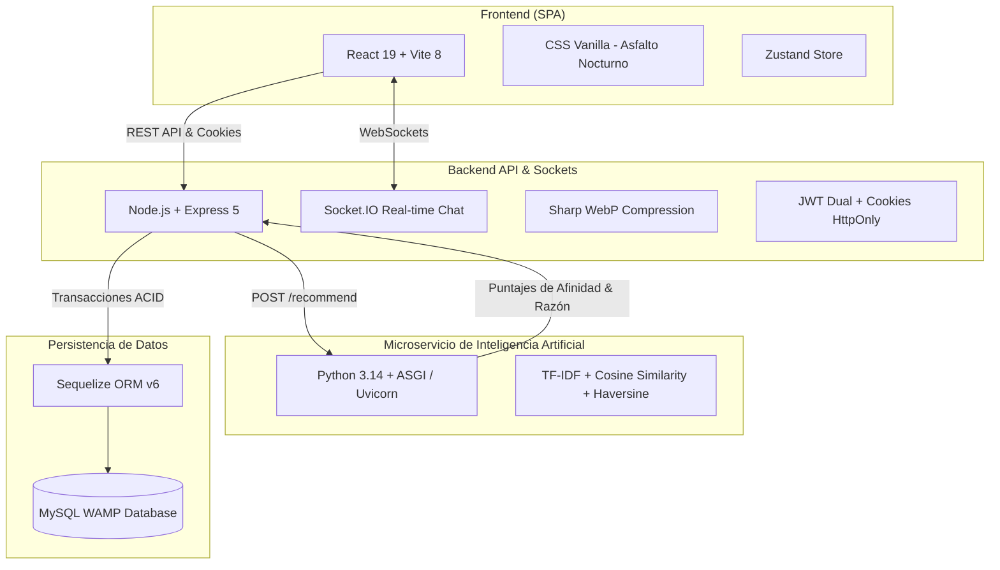

# ♻️ Segunda Vuelta - Plataforma de Economía Circular e Intercambio de Indumentaria
**Memoria Técnica, Justificación Pedagógica y Arquitectura de Software**  
*Concurso Provincial / Nacional de Proyectos Tecnológicos 2026*

---

## 1. Diagnóstico del Problema y Oportunidad

### La Crisis del Fast Fashion
La industria global de la indumentaria se ha convertido en la **segunda industria más contaminante del planeta**:
- Representa el **10% de todas las emisiones globales de gases de efecto invernadero**.
- Consume **215 billones de litros de agua al año**.
- En Argentina, decenas de miles de toneladas de ropa en perfecto estado terminan anualmente en basurales a cielo abierto o rellenos sanitarios del CEAMSE.

### La Barrera Económica
El precio de prendas urbanas y deportivas originales (camisetas oficiales de fútbol, camperas técnicas, buzos streetwear, calzado de marca) ha sufrido una inflación desmedida, alejando a los jóvenes y trabajadores del acceso a indumentaria de calidad.

### La Solución: Segunda Vuelta
**Segunda Vuelta** es una plataforma digital de economía circular que transforma los placares inactivos en un ecosistema de intercambio comunitario (*swap*), **sin intermediación monetaria**, impulsado por geolocalización, validación criptográfica de seguridad y un motor de **Inteligencia Artificial** que recomienda prendas compatibles por estilo y cercanía.

---

## 2. Impacto Ambiental y Métricas de Economía Circular

Por cada intercambio completado en la plataforma:

| Métrica Ambiental | Ahorro por Intercambio | Equivalencia en la Vida Real |
|---|---|---|
| **Huella Hídrica** | **2.700 a 4.000 litros de agua** | Agua potable que bebe una persona durante 3 años |
| **Huella de Carbono** | **10 a 14 kg de CO₂eq mitigados** | Emisiones de un auto a combustión recorriendo 80 km |
| **Residuos Textiles** | **0.5 a 1.2 kg de tela salvada** | Se evita su degradación anaeróbica en rellenos sanitarios |
| **Logística de Última Milla** | **0 emisiones de flete** | Intercambios presenciales de cercanía (a pie / bicicleta) |

---

## 3. Arquitectura del Sistema



---

## 4. Stack Tecnológico Detallado

### Frontend
- **React 19 & Vite 8**: Carga instantánea con HMR y rendering optimizado.
- **Sistema de Diseño "Asfalto Nocturno"**: Paleta con tokens HSL oscuros, acentos neón (#C8102E, #00F2FE), tipografías *Inter* y *Space Grotesk*. Cero emojis; iconografía profesional de *Lucide React*.
- **Zustand**: Gestión de estado reactivo para autenticación y filtros de catálogo.
- **React Router v6**: Navegación client-side y control de rutas privadas/públicas.

### Backend & Seguridad
- **Express 5**: Enrutamiento moderno y tipado con controladores modulares.
- **Socket.IO**: Chat en tiempo real con salas dedicadas por intercambio, confirmación de lectura y envío de imágenes con compresión en memoria.
- **Seguridad multicapa**:
  - `helmet`: Protección de encabezados HTTP.
  - `express-rate-limit`: Prevención de ataques de fuerza bruta y saturación.
  - `cookieParser`: Almacenamiento seguro de tokens de refresco (`httpOnly`, `sameSite`).
  - `Sharp`: Conversión y compresión a WebP (ahorro del 75% del ancho de banda).

### Inteligencia Artificial (Microservicio de Recomendaciones)
- **Python 3.14 + ASGI / Uvicorn** en puerto 8000.
- **Algoritmo de Filtrado Basado en Contenido (Content-Based Filtering)**:
  1. *Tokenización y limpieza semántica*: Normalización de texto y eliminación de stopwords en español.
  2. *TF-IDF Vector Space Model*: Matriz de términos frecuentes e inversos ponderados sobre título, descripción, marca y categoría.
  3. *Similitud de Coseno*: Cálculo del ángulo vectorial entre la prenda objetivo y el inventario disponible.
  4. *Penalización Geoespacial Haversine*: Ponderación de cercanía en kilómetros respecto al usuario.
  5. *Score Híbrido*:
     $$\text{Score Final} = 0.40 \times \text{Similitud Textual} + 0.40 \times \text{Match Categórico/Estilo} + 0.20 \times \text{Proximidad Haversine}$$

---

## 5. Protocolo de Seguridad e Intercambio Seguro en 4 Capas

```
[ Usuario A propone prenda ]
             │
             ▼
[ Usuario B acepta la propuesta ]
             │
             ▼
[ Sistema formaliza el Swap ] ───► Genera Código Único OTP (ej: SV94B82X)
             │                 ───► Inicia temporizador irrevocable de 72 horas
             ▼
[ Encuentro presencial en punto seguro ]
             │
             ▼
[ Validación cruzada del código en la plataforma ]
             │
             ▼
[ Intercambio Completado ] ───► Habilitación de Reseñas Mutuas con Estrellas
                           ───► Recálculo dinámico de reputación del usuario
```

1. **Código Alfanumérico Único de 8 Caracteres**: Impide que cualquiera de las partes confirme la recepción sin haber revisado la prenda en persona.
2. **Expiración Estricta de 72 Horas**: Si el intercambio no se concreta en 72 horas, las prendas vuelven automáticamente al catálogo público.
3. **Reseñas Verificadas**: Solo los usuarios que concluyeron un swap pueden calificar (1.0 a 5.0 estrellas), evitando fraudes y cuentas infladas.
4. **Panel de Moderación & BanLog**: Cola de denuncias en tiempo real para el equipo administrador con auditoría de suspensiones obligatoria.

---

## 6. Conclusión y Proyección
Segunda Vuelta combina tecnología web moderna, modelos de aprendizaje automático y compromiso medioambiental en una solución escalable, replicable en cualquier ciudad del país y con impacto social directo.
